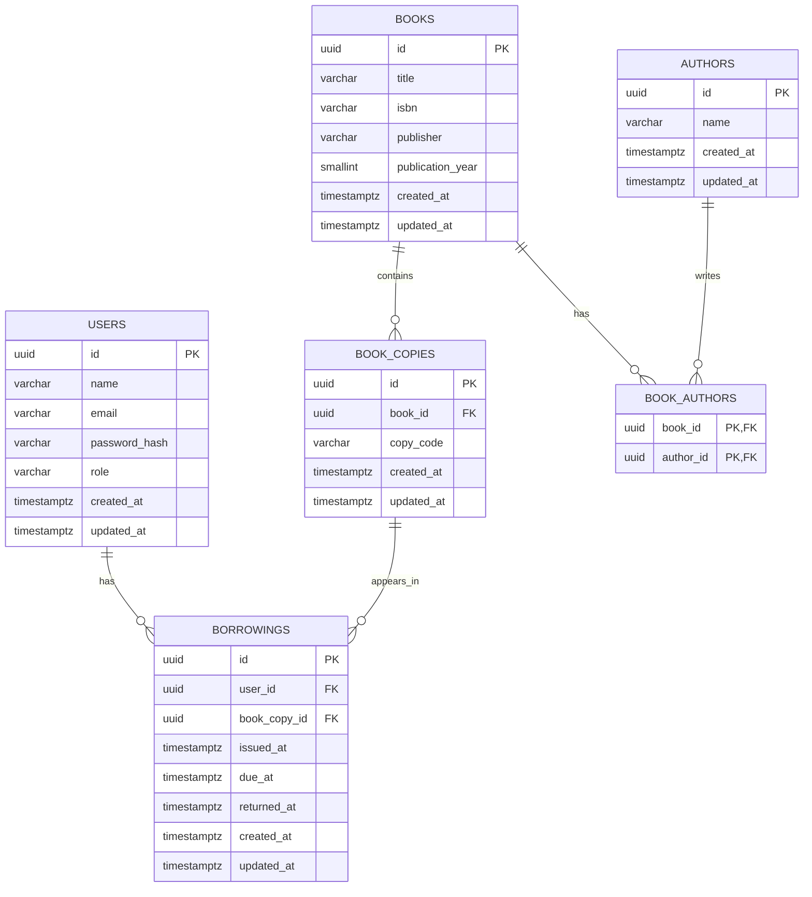

# Library Management System — Database Design

## 1. Overview

### Purpose

Define the relational database schema for the Library Management System before implementing ORM models.

### Database

- **Database:** PostgreSQL
- **Naming convention:** `snake_case`
- **Primary key strategy:** UUID
- **Timestamp convention:** `TIMESTAMPTZ`
- **Schema approach:** Normalized relational schema with database-enforced integrity constraints.

### Design principles

- Separate book titles from individual physical copies.
- Separate authentication and role information from borrowing records.
- Enforce relationships and uniqueness through database constraints.
- Use transactions for operations that modify borrowing records.
- Derive availability and overdue status instead of storing redundant values.
- Keep the schema limited to MVP requirements.

---

## 2. Entities

| Entity | Purpose |
| --- | --- |
| `users` | Student and librarian accounts |
| `authors` | Author information |
| `books` | Book titles and bibliographic details |
| `book_authors` | Many-to-many relationship between books and authors |
| `book_copies` | Individual physical copies |
| `borrowings` | Issue, due date, and return records |

### Relationships

- A user can have multiple borrowing records.
- A book can have multiple physical copies.
- A book can have multiple authors.
- An author can be associated with multiple books.
- A physical copy can have multiple borrowing records over time.
- A physical copy can have at most one active borrowing at a time.

---

## 3. Table Definitions

### 3.1 `users`

Stores authentication details and user roles.

| Column | Data type | Constraints | Description |
| --- | --- | --- | --- |
| `id` | UUID | Primary key, default `gen_random_uuid()` | Unique user identifier |
| `name` | VARCHAR(100) | NOT NULL | Full name |
| `email` | VARCHAR(255) | NOT NULL | Login email |
| `password_hash` | VARCHAR(255) | NOT NULL | Hashed password |
| `role` | VARCHAR(20) | NOT NULL, CHECK constraint | User role |
| `created_at` | TIMESTAMPTZ | NOT NULL, default `CURRENT_TIMESTAMP` | Creation timestamp |
| `updated_at` | TIMESTAMPTZ | NOT NULL, default `CURRENT_TIMESTAMP` | Last update timestamp |

Design decisions:

- Passwords must never be stored in plaintext.
- Email uniqueness is enforced case-insensitively through a unique index on `LOWER(email)`.
- The application must use a consistent email normalization policy for registration and login.
- Public student registration must always assign the `STUDENT` role on the server.
- Users must not be able to assign themselves the `LIBRARIAN` role.
- Librarian accounts must be provisioned through a controlled process.

Constraints:

- Primary key on `id`.
- `name`, `email`, `password_hash`, and `role` are required.
- Check constraint: `role IN ('STUDENT', 'LIBRARIAN')`.
- Unique expression index on `LOWER(email)`.
- Do not add a separate case-sensitive unique constraint on `email`, because the expression index is the definitive uniqueness mechanism.

### 3.2 `authors`

Stores author information.

| Column | Data type | Constraints | Description |
| --- | --- | --- | --- |
| `id` | UUID | Primary key, default `gen_random_uuid()` | Unique author identifier |
| `name` | VARCHAR(150) | NOT NULL | Author name |
| `created_at` | TIMESTAMPTZ | NOT NULL, default `CURRENT_TIMESTAMP` | Creation timestamp |
| `updated_at` | TIMESTAMPTZ | NOT NULL, default `CURRENT_TIMESTAMP` | Last update timestamp |

Design decisions:

- Authors are stored independently of books.
- An author may be associated with multiple books.
- An author referenced by a book must not be deleted without first handling the relationship.

Constraints:

- Primary key on `id`.
- `name` is required.

### 3.3 `books`

Stores bibliographic information about book titles, not individual physical copies.

| Column | Data type | Constraints | Description |
| --- | --- | --- | --- |
| `id` | UUID | Primary key, default `gen_random_uuid()` | Unique book identifier |
| `title` | VARCHAR(255) | NOT NULL | Book title |
| `isbn` | VARCHAR(20) | Nullable, UNIQUE when provided | ISBN |
| `publisher` | VARCHAR(150) | Nullable | Publisher |
| `publication_year` | SMALLINT | Nullable, CHECK constraint | Publication year |
| `created_at` | TIMESTAMPTZ | NOT NULL, default `CURRENT_TIMESTAMP` | Creation timestamp |
| `updated_at` | TIMESTAMPTZ | NOT NULL, default `CURRENT_TIMESTAMP` | Last update timestamp |

Design decisions:

- A book represents a title or edition in the catalogue.
- Physical copies are stored separately in `book_copies`.
- ISBN is optional because some catalogue entries may not have one.
- If provided, ISBN must be unique.
- ISBN format validation should be performed by the application.

Constraints:

- Primary key on `id`.
- `title` is required.
- Unique constraint on `isbn`; PostgreSQL permits multiple `NULL` values in a normal unique constraint.
- `publication_year` is nullable. When provided, it must be at least `1000`. Enforce this lower bound with a PostgreSQL `CHECK` constraint. Validate the upper bound in the application layer: the publication year must not exceed the current calendar year.

Recommended database constraint:

```sql
CHECK (
    publication_year IS NULL
    OR publication_year >= 1000
)
```

Do not use `CURRENT_DATE` in this `CHECK` constraint. PostgreSQL check constraints are expected to use immutable expressions, and the constraint would not automatically revalidate existing rows as the calendar year changes.

Author association rule:
A book may temporarily exist without an author association while it is being entered or edited. However, the application must require at least one associated author before considering a book fully catalogued.

This cross-table requirement is enforced in the application service layer within the relevant create/update transaction. It is not enforced by a simple `CHECK` constraint because PostgreSQL check constraints cannot directly enforce conditions across related rows.

### 3.4 `book_authors`

Associates books with authors.

| Column | Data type | Constraints | Description |
| --- | --- | --- | --- |
| `book_id` | UUID | NOT NULL, FK to `books.id` | Associated book |
| `author_id` | UUID | NOT NULL, FK to `authors.id` | Associated author |

Design decisions:

- Implements a many-to-many relationship.
- A book can have multiple authors.
- An author can be associated with multiple books.
- Duplicate book-author associations are prohibited.

Constraints:

- Composite primary key: (`book_id`, `author_id`).
- `book_id` references `books.id` with `ON DELETE CASCADE`.
- `author_id` references `authors.id` with `ON DELETE RESTRICT`.
- An index on `author_id` supports finding books associated with an author.

### 3.5 `book_copies`

Stores individual physical copies available for borrowing.

| Column | Data type | Constraints | Description |
| --- | --- | --- | --- |
| `id` | UUID | Primary key, default `gen_random_uuid()` | Unique copy identifier |
| `book_id` | UUID | NOT NULL, FK to `books.id` | Parent book |
| `copy_code` | VARCHAR(50) | NOT NULL, UNIQUE | Library copy identifier |
| `created_at` | TIMESTAMPTZ | NOT NULL, default `CURRENT_TIMESTAMP` | Creation timestamp |
| `updated_at` | TIMESTAMPTZ | NOT NULL, default `CURRENT_TIMESTAMP` | Last update timestamp |

Design decisions:

- Every physical copy has a unique identifier.
- Multiple copies may reference the same book.
- Availability is derived from active borrowing records.
- A copy is issued when an active borrowing record exists.
- A copy is available when no active borrowing record exists.

Constraints:

- Primary key on `id`.
- Foreign key `book_id` references `books.id` with `ON DELETE RESTRICT`.
- `copy_code` is required and unique.
- A book with physical copies cannot be deleted through ordinary catalogue operations.

Why availability is derived:
Maintaining a separate `is_available` field can produce inconsistent state between the copy and its borrowing record. Deriving availability from borrowing records avoids this duplication.

### 3.6 `borrowings`

Stores each issue and return event.

| Column | Data type | Constraints | Description |
| --- | --- | --- | --- |
| `id` | UUID | Primary key, default `gen_random_uuid()` | Unique borrowing identifier |
| `user_id` | UUID | NOT NULL, FK to `users.id` | Borrowing student |
| `book_copy_id` | UUID | NOT NULL, FK to `book_copies.id` | Physical copy |
| `issued_at` | TIMESTAMPTZ | NOT NULL, default `CURRENT_TIMESTAMP` | Issue timestamp |
| `due_at` | TIMESTAMPTZ | NOT NULL | Due timestamp |
| `returned_at` | TIMESTAMPTZ | Nullable | Return timestamp |
| `created_at` | TIMESTAMPTZ | NOT NULL, default `CURRENT_TIMESTAMP` | Record creation timestamp |
| `updated_at` | TIMESTAMPTZ | NOT NULL, default `CURRENT_TIMESTAMP` | Last update timestamp |

Design decisions:

- Each issue creates one borrowing record.
- Returning a copy updates `returned_at`.
- A record with `returned_at IS NULL` represents an active borrowing.
- Historical borrowing records are retained.
- Overdue status is derived from `due_at`, `returned_at`, and the current timestamp.
- Book title information is obtained through `book_copies.book_id`, avoiding duplicate storage.

Constraints:

- Primary key on `id`.
- Foreign key `user_id` references `users.id` with `ON DELETE RESTRICT`.
- Foreign key `book_copy_id` references `book_copies.id` with `ON DELETE RESTRICT`.
- `due_at > issued_at`.
- `returned_at IS NULL OR returned_at >= issued_at`.
- Only student accounts may borrow copies. This is enforced by the application service layer, which validates the user's role before creating a borrowing record.

Preventing duplicate active borrowing:
Create a partial unique index on `book_copy_id` for rows where `returned_at IS NULL`.

This ensures that one physical copy cannot have more than one active borrowing record, including when concurrent issue requests reach the database.

---

## 4. Relationships and Cardinality

| Relationship | Cardinality | Implementation |
| --- | --- | --- |
| User → Borrowings | One-to-many | `borrowings.user_id` |
| Book → Book Copies | One-to-many | `book_copies.book_id` |
| Book → Authors | Many-to-many | `book_authors` |
| Author → Books | Many-to-many | `book_authors` |
| Book Copy → Borrowings | One-to-many over time | `borrowings.book_copy_id` |

### Relationship rules

1. A user may have zero or more borrowing records.
2. A book may have zero or more physical copies.
3. A fully catalogued book must have at least one author association.
4. A physical copy may have multiple historical borrowing records.
5. A physical copy may have at most one active borrowing record.
6. A borrowing record must reference an existing student and physical copy.
7. A normal return operation must preserve the borrowing record.

---

## 5. Normalization

The schema targets Third Normal Form (3NF).

### First Normal Form (1NF)

- Each column stores a single value.
- Authors are not stored as comma-separated strings in `books`.
- Physical copies are represented by individual rows.

### Second Normal Form (2NF)

- `book_authors` uses a composite primary key.
- Neither `book_id` nor `author_id` alone identifies an association row.
- The association table has no non-key attributes dependent on only part of the key.

### Third Normal Form (3NF)

- Author information is stored in `authors`.
- Physical copy identifiers are stored in `book_copies`.
- Issue and return details are stored in `borrowings`.
- Book titles are obtained through relationships rather than duplicated in borrowing records.

### Derived values

Do not independently store these values in the initial MVP:

- Available copy count.
- Issued copy count.
- Overdue status.
- Total borrowing count.

Derive them from the underlying records to avoid update anomalies.

---

## 6. Primary Keys and Foreign Keys

### Primary keys

- `users.id`
- `authors.id`
- `books.id`
- `book_copies.id`
- `borrowings.id`

These use UUIDs. `book_authors` uses the composite primary key (`book_id`, `author_id`).

### Foreign keys and delete behavior

| Foreign key | References | Delete behavior |
| --- | --- | --- |
| `book_authors.book_id` | `books.id` | `ON DELETE CASCADE` |
| `book_authors.author_id` | `authors.id` | `ON DELETE RESTRICT` |
| `book_copies.book_id` | `books.id` | `ON DELETE RESTRICT` |
| `borrowings.user_id` | `users.id` | `ON DELETE RESTRICT` |
| `borrowings.book_copy_id` | `book_copies.id` | `ON DELETE RESTRICT` |

Catalogue associations may be removed when a book is deleted, but users and physical copies with borrowing history must not be deleted in a way that destroys historical records.

Soft deletion or archival may be introduced later if needed.

---

## 7. Constraints and Integrity Rules

### User integrity

- Email must be unique regardless of letter case.
- Password hashes must be present.
- Role must be `STUDENT` or `LIBRARIAN`.
- Public student registration must not grant librarian privileges.

### Catalogue integrity

- Book title is required.
- A provided ISBN must be unique.
- Each physical copy must have a unique `copy_code`.
- Each copy must reference an existing book.
- Each book-author association must reference an existing book and author.
- A fully catalogued book must have at least one author.

### Borrowing integrity

- Each borrowing must reference an existing student and physical copy.
- Due timestamp must be later than issue timestamp.
- Return timestamp cannot precede issue timestamp.
- A physical copy may have at most one active borrowing.
- An already-issued copy cannot be issued again.
- Returning a copy must preserve its borrowing history.

### Enforcement strategy

Use database constraints for primary keys, foreign keys, uniqueness, checks, and concurrency-sensitive rules.

Use transactional application logic for:

- Checking student eligibility.
- Ensuring a fully catalogued book has an author.
- Issuing an available copy.
- Returning an active borrowing.
- Enforcing librarian permissions.
- Validating that `publication_year` does not exceed the current calendar year.

---

## 8. Indexes

| Table | Index | Purpose |
| --- | --- | --- |
| `users` | Unique expression index on `LOWER(email)` | Case-insensitive login and duplicate prevention |
| `books` | Unique index on `isbn` | ISBN lookup and uniqueness |
| `books` | Index on `title` | Catalogue filtering and sorting |
| `book_authors` | Composite primary key (`book_id`, `author_id`) | Find authors associated with a book |
| `book_authors` | Index on `author_id` | Find books associated with an author |
| `book_copies` | Index on `book_id` | Find copies belonging to a book |
| `book_copies` | Unique index on `copy_code` | Locate a physical copy |
| `borrowings` | Index on (`user_id`, `issued_at`) | Student borrowing history |
| `borrowings` | Partial index on `due_at` for active borrowings | Overdue queries |
| `borrowings` | Partial unique index on `book_copy_id` where `returned_at IS NULL` | Prevent duplicate active borrowing |

### Indexing principles

- Primary keys and unique constraints already provide indexes where PostgreSQL creates them.
- Avoid redundant indexes.
- Index frequent filters, joins, and sorting columns.
- Review query patterns before adding speculative indexes.

---

## 9. Availability and Overdue Logic

### Copy availability

A copy is available when no borrowing record exists for it with `returned_at IS NULL`.

- **Available:** no active borrowing exists.
- **Issued:** an active borrowing exists.

Catalogue and summary queries must use this same definition.

### Overdue status

A borrowing is overdue when:

- `returned_at IS NULL`, and
- `due_at < CURRENT_TIMESTAMP`.

Overdue status is derived at query time and does not require a separate column or background job.

### Summary counts

The dashboard can derive:

- Total titles from `books`.
- Total physical copies from `book_copies`.
- Available copies from copies without active borrowings.
- Issued copies from active borrowing records.
- Total students from `users` filtered by `role = 'STUDENT'`.
- Overdue borrowings from active borrowings whose due timestamps have passed.

---

## 10. Transactions and Concurrency

Issue and return operations must use database transactions.

### Issue workflow

1. Begin a transaction.
2. Verify that the user is an eligible student.
3. Lock the physical copy row or otherwise serialize competing issue attempts.
4. Verify that the copy exists and has no active borrowing.
5. Insert a borrowing record with issue and due timestamps.
6. Commit the transaction.
7. Roll back if validation or persistence fails.

The partial unique index on active borrowings is the final database-level safeguard against concurrent duplicate issues.

### Return workflow

1. Begin a transaction.
2. Find and lock the active borrowing record.
3. Verify that the borrowing exists and has not been returned.
4. Set `returned_at` to the return timestamp.
5. Update `updated_at`.
6. Commit the transaction.
7. Roll back if the operation fails.

Repeated return requests must not create another borrowing record or silently overwrite an existing return timestamp.

---

## 11. Timestamp Management

All timestamps use `TIMESTAMPTZ`.

- `created_at`: set when a record is created.
- `updated_at`: maintained whenever a record changes.
- `issued_at`: issue timestamp.
- `due_at`: return deadline.
- `returned_at`: return timestamp, or `NULL` while active.

`DEFAULT CURRENT_TIMESTAMP` does not automatically update `updated_at` on later changes. For the MVP, update it consistently in application logic. A database trigger is an alternative if centralized timestamp maintenance becomes necessary.

Persist timestamps consistently and preferably in UTC; format them for users in the frontend.

---

## 12. Delete and Update Behavior

| Operation | Expected behavior |
| --- | --- |
| Delete a book without physical copies | Allowed after handling author associations |
| Delete a book with physical copies | Restricted |
| Delete an author referenced by books | Restricted until associations are removed |
| Delete a student with borrowing history | Restricted |
| Delete a librarian account | Controlled operation |
| Delete a copy with borrowing history | Restricted |
| Return a copy | Update the active borrowing and preserve history |
| Update book metadata | Allowed without changing physical copies |
| Update a copy identifier | Allowed if uniqueness and operational references remain valid |

Deleting records involved in borrowing history must not be part of normal issue/return workflows.

---

## 13. Schema Diagram



---

## 14. Pending Decisions

Finalize these during backend and database setup:

1. Confirm PostgreSQL support for `gen_random_uuid()`.
2. Implement the case-insensitive email unique index and consistent normalization policy.
3. Confirm whether additional book metadata is needed.
4. Decide the default borrowing duration.
5. Decide whether copy codes are manually entered or generated.
6. Define the initial librarian provisioning process.
7. Confirm whether soft deletion is needed.
8. Configure the database migration approach.

Do not add features solely to resolve decisions that are not required for the MVP.

---

## 15. Out of Scope

The initial schema does not include:

- Reservations or holds.
- Fine calculation or payment records.
- Multiple library branches.
- Notifications and reminders.
- Barcode or RFID integrations.
- Recommendations and advanced analytics.
- Separate audit-event infrastructure beyond borrowing history.

These features can be introduced later if requirements justify them.

---

## 16. Acceptance Criteria

- [x] All MVP entities are documented.
- [x] Every table has documented columns, data types, and constraints.
- [x] Primary and foreign keys are defined.
- [x] Relationships and cardinalities are documented.
- [x] Normalization decisions are explained.
- [x] Uniqueness and check constraints are specified.
- [x] Indexes are justified by query patterns or integrity requirements.
- [x] Issue/return transactions and concurrency protections are documented.
- [x] Availability and overdue status have unambiguous definitions.
- [x] Delete/update behavior protects borrowing history.
- [x] Pending decisions and out-of-scope features are documented.
- [x] The document has been reviewed against `docs/requirements.md`.

**Deliverable:** `docs/database-design.md`

**Next phase:** Phase 3 — Backend Setup.
